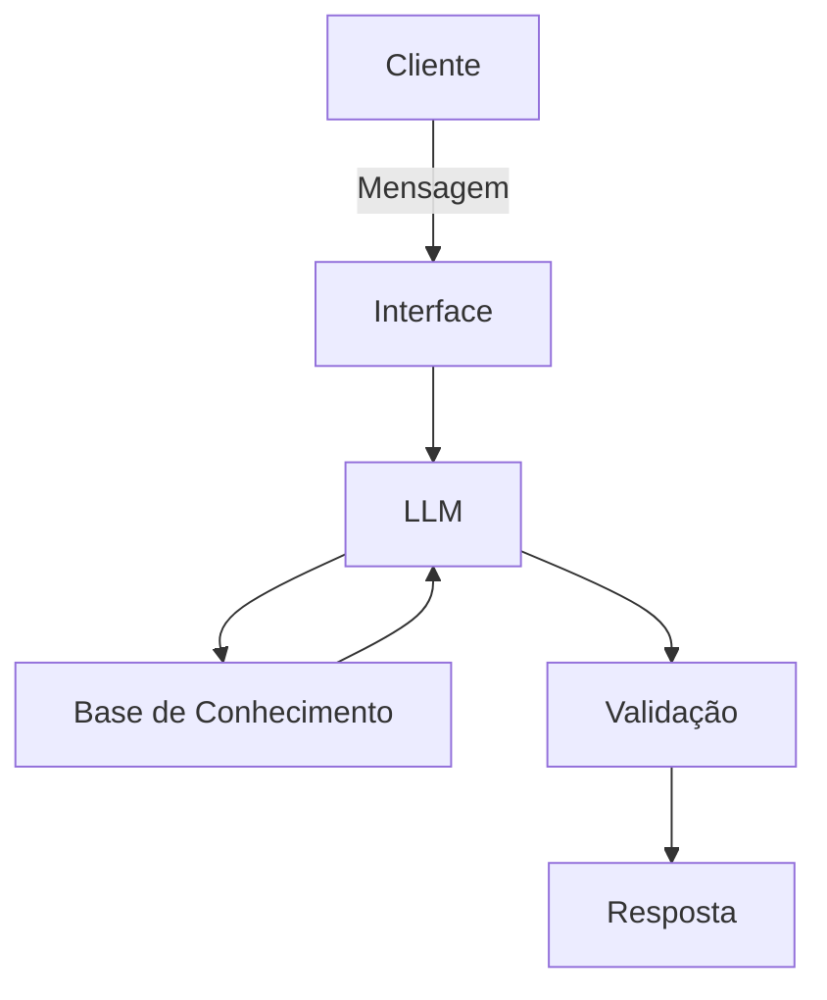

# Documentação do Agente

## Visão Geral

* **Nome do Agente:** MetasBot / SmartFinance Assistant 
* **Tema:** Metas Financeiras (O "Onde" e o "Quando") 
* **Propósito:** Atuar como um assistente virtual inteligente voltado para a ação, planejamento e acompanhamento quantitativo da jornada financeira do usuário.

## Caso de Uso

### Problema
> Qual problema financeiro seu agente resolve?

Muitas pessoas têm dificuldade em concretizar objetivos financeiros por falta de planejamento prático, 
não sabem quanto precisam poupar mensalmente para atingir objetivos específicos
e se perdem no controle de prazos (curto, médio e longo prazo) ou quando gastam além do planejado.

### Solução
> Como o agente resolve esse problema de forma proativa?

  * Estruturando objetivos reais de vida (como compra de casa, criação de reserva de emergência ou quitação de dívidas) ;
  * Realizando cálculos matemáticos precisos de quanto dinheiro é necessário poupar por mês ;
  * Fornecendo monitoramento contínuo, alertas de progresso e ajustes de rota automáticos caso o usuário gaste mais do que devia ;
  * É capaz de juntar informações de diferentes meios, em prol de fazer uma avaliação completa sobre o rendimento da pessoa .

### Público-Alvo
> Quem vai usar esse agente?

Pessoas que buscam orientações práticas para estruturar metas financeiras, planejar o orçamento e conquistar objetivos de curto, médio e longo prazo com o auxílio de inteligência artificial.

---

## Persona e Tom de Voz

### Nome do Agente

MetasBot / SmartFinance Assistant

### Personalidade
> Como o agente se comporta? (ex: consultivo, direto, educativo)

Direto, educativo, analítico, consultivo e proativo. Focado em orientar o usuário na tomada de decisões realistas sem perder o foco.

### Tom de Comunicação
> Formal, informal, técnico, acessível?

Formal na medida certa, porém simples, claro e altamente acessível,
evitando termos técnicos excessivamente complexos sem antes explicá-los.
Formal, Simples e Acessível.

### Exemplos de Linguagem

* **Saudação:** *"Olá! Como posso ajudar com suas finanças hoje e te aproximar dos seus objetivos?"*
* **Confirmação:** *"Entendi! Vou calcular o valor mensal necessário para alcançar essa meta e verificar seu progresso."*
* **Erro/Limitação:** *"No momento não tenho acesso aos seus extratos bancários em tempo real, mas posso recalcular seu plano com base nos novos dados informados."*

---

## Arquitetura

### Diagrama

### Componentes

| Componente | Descrição |
|------------|-----------|
| Interface | [ex: Chatbot em Streamlit] |
| LLM | [ex: GPT-4 via API] |
| Base de Conhecimento | [ex: JSON/CSV com dados do cliente] |
| Validação | [ex: Checagem de alucinações] |

---

## Segurança e Anti-Alucinação

### Estratégias Adotadas

- [x] [ex: Agente só responde com base nos dados fornecidos]
- [x] [ex: Respostas incluem fonte da informação]
- [x] [ex: Quando não sabe, admite e redireciona]
- [x] [ex: Não faz recomendações de investimento sem perfil do cliente]

### Limitações Declaradas
> O que o agente NÃO faz?

Não substitui consultoria financeira profissional certificada para investimentos complexos ;
Não responde a questões que não estejam relacionadas a finanças, orçamentos ou metas ;   
Não realiza transações bancárias reais .
